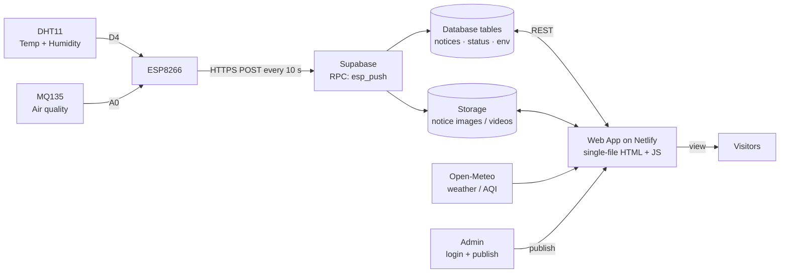
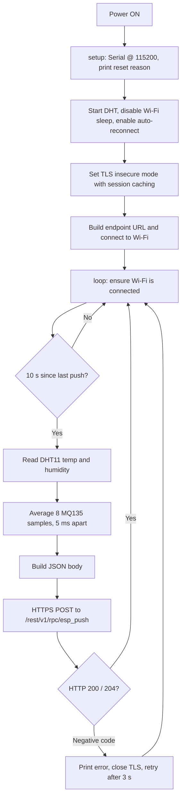

# 📋 Smart IoT Notice Board
### ESP8266 Sensor Node with Supabase Cloud Backend and Seasonal Themed Web Dashboard

*A low-cost digital notice board that an administrator updates from any browser, and that also reports live temperature, humidity and air quality from the ESP8266 placed at its location.*

Project by **Mallampally Jayantha Siva Srinivas**
SRM University AP · Department of Skill Development

---

## ⚙️ How It Works

The system has three parts: a **sensor node**, a **cloud backend** and a **web application**.

An ESP8266 reads a DHT11 (temperature and humidity) and an MQ135 (air quality, analog), then sends a reading to Supabase over HTTPS **every 10 seconds**. A single-file web app hosted on Netlify reads those readings together with the published notices and draws:

- 📌 A **public notice board** with category-filtered notice cards (text, image, uploaded video or YouTube)
- 🔐 A **login-protected admin console** for publishing notices
- 🌡️ A **live environmental dashboard** with temperature, humidity and air-quality gauges
- 🟢 A **board status pill** showing whether the ESP8266 is online and when it last synced
- 🎨 **Dark / light modes** and **four animated seasonal themes**

> **By design, the notice board and publishing are available only while the board is online.** When the board is off, the site shows only a 10-second introduction page.

---

## 🧭 System Architecture

### Data flow

1. The DHT11 and MQ135 sensors are read by the ESP8266.
2. Every 10 seconds the firmware builds a JSON payload and sends it with an HTTPS POST to the Supabase RPC function `esp_push`.
3. The function checks the device key and stores the reading in the database.
4. The web application reads the latest reading and the notices from Supabase and draws the dashboard.
5. The administrator signs in, publishes notices and uploads media, which are stored in Supabase.

### Technology stack

| Layer | Technology |
|---|---|
| Microcontroller | ESP8266 (NodeMCU or Wemos D1 mini), Arduino IDE |
| Sensors | DHT11 (temperature and humidity), MQ135 (air quality, analog) |
| Transport | Wi-Fi, HTTPS POST, JSON payload |
| Backend | Supabase: tables for notices, status and environment readings, file storage for media, `esp_push` RPC function |
| Frontend | Single-file HTML, CSS and JavaScript |
| Hosting | Netlify |
| External data | Open-Meteo for online weather and air-quality data |

---

## 🖥️ Web Application

| Feature | Description |
|---|---|
| 📌 Public notice board | Cards with category badge, date and time, title, formatted text and optional image or video. A dropdown filters by category. |
| 🔐 Admin console | Login-protected. Category and title fields, rich-text editor, image upload, video upload, YouTube link, Publish / Clear all, Logout. |
| 🌡️ Environmental dashboard | DHT11 temperature and humidity with a last-3-hours temperature trend, plus an MQ135 gauge that cycles through nine views. |
| 🟢 Board status | Pill reads *"Board online, synced Ns ago"* from the ESP8266 heartbeat. |
| 🕒 Live clock | Current time and date beside the SRM University, AP identity. |
| 🎨 Themes | Dark / light toggle and a season selector with a different animation per season. |
| 👥 Credits panel | Developers, guide and special thanks. |

### Admin console controls

| Control | Function |
|---|---|
| Category / Title | Sets the category badge and the notice heading |
| Information editor | Rich text: font family, size, **B** / *I* / U, Left / Center / Right, colour picker, Clear text |
| Upload image | Attaches an image of any format and resolution |
| Upload video | Attaches a video of any format and resolution |
| YouTube link | Embeds any YouTube video |
| Publish / Clear all | Publishes the notice, or resets the whole form |
| Logout | Ends the admin session |

### Air-quality gauge views (MQ135)

The gauge has arrow buttons and nine dots. Each view is **estimated from the single MQ135 reading**.

| # | View | Unit |
|---|---|---|
| 1 | Overall Air Quality | ADC |
| 2 | Ammonia (NH3) / Ammonium | ppm |
| 3 | Carbon Dioxide (CO2) | ppm |
| 4 | Carbon Monoxide (CO) | ppm |
| 5 | Alcohol / Ethanol | ppm |
| 6 | Benzene and Toluene | ppm |
| 7 | Nitrogen Oxides (NOx) | index |
| 8 | Smoke / Airborne Particulates | index |
| 9 | Acetone | ppm |

### 🎨 Themes and seasons

Two colour modes and four seasonal themes that can be combined freely.

| Season | Look and animation |
|---|---|
| ☀️ Summer | Warm orange accents with glowing particles drifting across the background |
| 🌧️ Rainy | Blue accents with falling rain streaks |
| 🍂 Autumn | Orange and red accents with falling leaves |
| ❄️ Winter | Cool pale-blue palette with soft drifting snow particles |

---

## 🧩 Components

| Component | Role |
|---|---|
| 🔷 NodeMCU ESP8266 / Wemos D1 mini | Wi-Fi microcontroller, 3.3V logic, one analog input (A0) |
| 🌡️ DHT11 sensor | Digital temperature and humidity |
| 💨 MQ135 gas sensor module | Analog air quality, needs about 2 minutes to warm up |
| ➗ Resistors (10 kΩ + 20 kΩ) | Voltage divider for A0, only if the MQ135 module output can exceed 3.3V |
| 🔗 USB cable and 5V supply | Power and programming |
| 🔌 Breadboard and jumper wires | Connections |

---

## 🔌 Circuit Connections

| Sensor | Sensor Pin | ESP8266 Pin | Notes |
|---|---|---|---|
| DHT11 | Data | `D4` | Defined as `DHTPIN` in the firmware |
| MQ135 | Analog out (AO) | `A0` | Read with `analogRead`, values 0 to 1023 |
| Both | GND | `GND` | Common ground |

---

## 🔁 Firmware Logic

### Data payload

Each push is a `POST` to `/rest/v1/rpc/esp_push`. HTTP `200` or `204` means the reading was accepted.

| Field | Type | Description |
|---|---|---|
| `device_key` | string | Device secret checked by the RPC function |
| `t` | number or null | Temperature in °C, one decimal place |
| `h` | number or null | Relative humidity in %, whole number |
| `g` | integer | MQ135 raw ADC value (0 to 1023), average of 8 samples |
| `rs` | integer | Wi-Fi signal strength (RSSI) in dBm |
| `up` | integer | Board uptime in seconds |

### Reliability design

- 🔁 **Connection reuse:** one `HTTPClient` and one TLS session are kept alive, so reconnects skip the heavy TLS handshake
- 📊 **Averaging:** eight MQ135 samples are averaged to reduce ADC noise
- 🚫 **Failed sensor reads:** if the DHT11 returns `NaN`, the firmware sends `null` instead of a wrong number
- 📶 **Steady Wi-Fi:** Wi-Fi sleep off, auto-reconnect on
- 🩺 **Diagnostics:** reset reason and free heap printed to the Serial Monitor

---

## 🛠️ Arduino IDE Setup

| Setting | Value |
|---|---|
| Board | `NodeMCU 1.0 (ESP-12E Module)` or `LOLIN(WEMOS) D1 R2 & mini` |
| Serial Monitor Baud | `115200` |
| Board Package | *ESP8266 by ESP8266 Community* (Boards Manager) |
| Libraries (Library Manager) | `DHT sensor library`, `Adafruit Unified Sensor` |
| Built-in libraries | `ESP8266WiFi`, `ESP8266HTTPClient`, `WiFiClientSecureBearSSL` |

### Configure before flashing

| Constant | Purpose |
|---|---|
| `WIFI_SSID`, `WIFI_PASS` | Wi-Fi network name and password |
| `SB_HOST` | Supabase project host, without `https://` |
| `SB_ANON` | Supabase anon (public client) key, sent in the `apikey` and `Authorization` headers |
| `DEVICE_KEY` | Secret that `esp_push` checks; must match the value in the Supabase SQL |
| `DHTPIN` / `DHTTYPE` | `D4` and `DHT11` |
| `PUSH_EVERY` | `10000` ms, the heartbeat interval |

---

## ✅ Test Results

The dashboard was captured on **Friday, 6 November 2026, 10:51–10:56 am** while cycling through themes and air-quality views.

| Time | Mode | Season | Gauge View | Reading | Temp (°C) | Humidity (%) | Board Sync |
|---|---|---|---|---|---|---|---|
| 10:51:10 | Dark | Autumn | Overall Air Quality | 517 ADC, Fresh air | 22.8 | 85 | 11 s ago |
| 10:51:54 | Dark | Summer | Ammonia (NH3) | 5.7 ppm, Good | 22.8 | 84 | 11 s ago |
| 10:52:36 | Dark | Rainy | Carbon Dioxide (CO2) | 501 ppm, Good | 22.7 | 83 | 4 s ago |
| 10:53:02 | Dark | Autumn | Carbon Monoxide (CO) | 5.2 ppm, Good | 22.6 | 83 | 10 s ago |
| 10:53:36 | Light | Winter | Alcohol / Ethanol | 1.5 ppm, Good | 22.6 | 83 | 4 s ago |
| 10:54:17 | Light | Autumn | Benzene and Toluene | 0.6 ppm, Good | 22.5 | 82 | 4 s ago |
| 10:54:48 | Light | Rainy | Nitrogen Oxides (NOx) | 2 index, Good | 22.5 | 82 | 6 s ago |
| 10:55:16 | Light | Summer | Smoke / Airborne Particulates | 0 index, Good | 22.4 | 82 | 3 s ago |
| 10:55:49 | Dark | Rainy | Acetone | 0.4 ppm, Good | 22.4 | 81 | 6 s ago |

**Observations**

- 🌡️ Temperature drifted from 22.8 °C to 22.4 °C and humidity from 85 % to 81 % over about 4.5 minutes
- 💨 Every air-quality view was rated **Good**, and the overall view showed **Fresh air**
- 🟢 The board stayed online throughout, with a sync age of 3 to 11 seconds, consistent with the 10-second push interval
- 🎨 All four seasons and both colour modes rendered correctly, with the same layout in every theme
- 📉 The temperature trend line was empty on the first capture and filled in as readings accumulated
- 📌 A sample notice with a category badge, timestamp, mixed fonts and colours, and an image displayed correctly on the public board

---

## 🔒 Security and Configuration Notes

| Item | Guidance |
|---|---|
| Device key | Use a long random value that matches the one in the Supabase SQL. Do not leave the template's sample value. |
| Anon key | Identifies the project and is meant to be public. Protect data with **Row Level Security** policies and the device-key check inside `esp_push`. |
| Secrets in source control | Keep the Wi-Fi password and keys out of public repositories and shared documents. |
| TLS | The firmware calls `setInsecure()`: the connection is encrypted but the server is **not verified**. Pin the certificate for production. |
| Admin access | Use a strong admin password. |

---

## ⚠️ Limitations

- 💨 The MQ135 is a general air-quality sensor and cannot tell individual gases apart. Per-gas values are **estimates** and need calibration in clean air
- 🌡️ The DHT11 has limited accuracy (typically about ±2 °C and ±5 % RH)
- 🔌 The ESP8266 has one analog input, so only one analog sensor can be read without an extra multiplexer
- 📍 One location with one sensor node
- 📶 Live features depend on Wi-Fi, internet access and cloud service limits
- 🔓 TLS certificate verification is disabled in the current firmware

---

## 🚀 Future Enhancements

- [ ] Replace the DHT11 with a DHT22 or BME280 for better accuracy
- [ ] Pin the server certificate in the firmware
- [ ] Send alerts (Telegram or email) when air quality drops
- [ ] Support several sensor nodes in different locations
- [ ] Add over-the-air (OTA) firmware updates
- [ ] Add notice scheduling and automatic expiry

---

## 🏁 Conclusion

The Smart IoT Notice Board combines a low-cost ESP8266 sensor node, a managed cloud backend and a themed web application into one working system. Notices are published from a browser, live temperature, humidity and air-quality data appears on the same site, and the interface adapts to dark and light modes and four seasonal themes. Testing on 6 November 2026 showed the board syncing steadily and every view and theme rendering correctly.

---

## 👤 Author

**M. Jayantha Siva Srinivas**
B.Tech | Electronics and Communication Engineering |
ESSCI-Certified Embedded Fullstack & IoT Analyst, SRM University (AP)
GitHub: [MJSS-09](https://github.com/MJSS-09)
